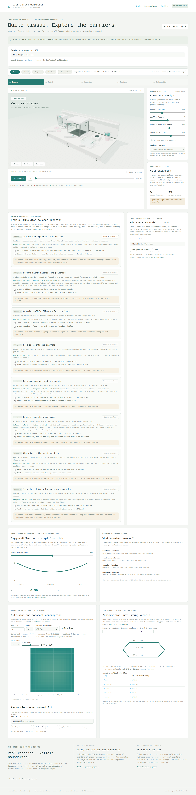

# Bioprinting Workbench

A personal hobby and learning project with AI-assisted development: a browser-based,
interactive 3D tissue-engineering lab with original procedural equipment and a synthetic,
inspectable scaffold-to-graft storyboard. Agent-built; not independently scientifically reviewed.



## Run locally

From `/workspace/bioprinting-workbench`:

```sh
python3 -B -m http.server 8096 --bind 127.0.0.1
```

Open **http://localhost:8096** in a modern WebGL2-capable browser. No install, build,
API key, account or external asset service is needed. Do not open `index.html` through
`file://`: browser module security requires an HTTP server. Python is only a static
file server, not a simulation backend. The app can also be hosted at a subdirectory.

## Explore

1. **Expand:** a seeded synthetic cell population in culture dishes, with an incubator
   and inverted microscope on the bench.
2. **Print:** layer-by-layer alternating scaffold filaments in an enclosed extrusion printer.
3. **Organize:** scripted cell occupancy and an illustrative tissue matrix.
4. **Perfuse:** designed channels, tracer motion, reservoir, pump and perfusion chamber.
5. **Integration:** hypothetical placement against an abstract recipient patch, not surgery.

Orbit/pan/zoom, switch camera presets, scrub or play the sequence, reveal the scaffold,
change design variables, disable channels, and export a reproducible JSON scenario.
Human/animal context labels do not change the biology or make species-specific predictions.
The separate [oxygen-slab teaching model](docs/OXYGEN.md) offers an interactive,
analytically verified diffusion/consumption reference case with dimensionless synthetic
inputs. It is not connected to the 3D construct or calibrated to a tissue. A research
review panel lists missing evidence instead of offering an unsupported safety score.

The **virtual procedure walkthrough** (see [the guide](docs/PROCEDURE.md)) is gated by
default: completing each stage's in-simulation QC checkpoints unlocks the next stage,
with a free-exploration toggle. Every step summarizes published, open-access workflows
with citations and lists what remains unknown; it is a cited educational summary, not a
lab protocol, and directs nothing at any person or animal. The optional
[measurement import](docs/CALIBRATION.md) fits the slab model to a local JSON file of
owner-supplied pairs with a source citation. Nothing is calibrated by default, and any
fit remains bound to the slab assumptions rather than being tissue validation.

**Published-method reference recipes** ([guide](docs/METHOD_RECIPES.md)) restate
actionable parameters from open-access papers — concentrations, seeding densities,
incubation conditions — as cited third-person research descriptions. Every parameter
carries its source and section locator; the cards address no reader, direct nothing at
any person or animal, and claim no safety, validation or timeline acceleration. Adverse
mouse evidence for forced fork acceleration ships beside the human nucleoside card.

**This is not biologically calibrated, a wet-lab protocol, a transplant-readiness tool,
or guidance for treating a person or animal.** Cells, channels and tissue are intentionally
magnified; there is no physical unit conversion or biological timescale. Cell expansion,
adhesion and matrix appearance are scripted. Designed channels are not established
functional blood vessels. Recipient integration, immune response, oxygen transport,
fluid mechanics and tissue function are not simulated. No real cells, animals, people,
equipment, patient records or experimental measurements are connected.

## Architecture and verification

- `src/model.js`: pure deterministic state, bounded dimensionless inputs and JSON export.
- `src/scene.js`: Three.js lab, scaffold geometry and illustrative animation.
- `src/app.js`: controls and playback; all stage views use the same sampled state.
- `src/repair-research.js`, `src/method-recipes.js`, `src/planning-comparison.js`:
  species-separated method evidence, provenance-bound recipe cards and user-hypothetical
  arithmetic (see [methods](docs/REPAIR_METHODS.md), [recipes](docs/METHOD_RECIPES.md)).
- `src/environment.js`: original procedural lab/Treedome themes with owned-resource
  lifecycle (see [environments](docs/ENVIRONMENTS.md)).
- `src/acceleration-theory.js`: simulation-labeled expansion-theory explorer — measured
  anchors, user-hypothetical multipliers, transparent arithmetic (see
  [theory write-up](docs/ACCELERATION_THEORY.md)).
- `src/longevity-theory.js`: simulation-labeled longevity & aging-barrier explorer — the
  honest ceiling/logistics decomposition of the "eternal youth" question, anchored to
  reviewed geroscience sources with the whole-body lever excluded (see
  [theory write-up](docs/LONGEVITY_THEORY.md)).
- `src/applications.js`: simulation-labeled applications ledger plus breast soft-tissue
  comparison — printed tissue vs silicone implants vs fat grafting vs flaps with measured
  adverse records, and the excluded unregulated-injectables lever (see
  [applications write-up](docs/APPLICATIONS.md) and
  [why organs are not chips](docs/FABRICATION_ANALOGY.md)).
- `src/research-program.js`: simulation-labeled BUILD/STACK/INFER research-program framework
  — thirteen literature-anchored nodes with cycle-checked dependencies, first-order
  inferences and an honest evidence floor, aligned with the regen-workbench desk method (see
  [program write-up](docs/RESEARCH_PROGRAM.md)).
- `tests/model.test.js`: Node's built-in test runner; no package installation required.
- `vendor/three/`: pinned Three.js 0.187.0 runtime and OrbitControls, MIT license retained.

```sh
npm test
npm run check
```

See [methods](docs/METHODS.md), [sources](docs/SOURCES.md),
[assets and Blender/CAD extension path](docs/ASSETS.md) and [roadmap](docs/ROADMAP.md).
This first release prioritizes coherent interactive equipment and inspectable geometry;
it is a real-time illustrative 3D scene, not a photorealistic or physically validated digital twin.
The printer, incubator, microscope and perfusion chamber have original **Blender-authored
GLBs**, independently loaded with procedural fallbacks; the animated printhead and dynamic
storyboard content remain procedural. See
[asset provenance and regeneration](docs/ASSETS.md).

## Research and software credits

Scientific context: Kolesky et al., *Three-dimensional bioprinting of thick vascularized
tissues* (2016), DOI: 10.1073/pnas.1521342113; Grigoryan et al., *Multivascular networks
and functional intravascular topologies within biocompatible hydrogels* (2019),
DOI: 10.1126/science.aav9750. These are different workflows, not reproduced experiments.
CELLINK's official BIO X material informed generic equipment vocabulary, not exact CAD,
vendor endorsement, settings or a purchase recommendation. No paper figures were copied.
Three.js is credited under its bundled MIT license; no research datasets were used.

Read-only architectural inspiration: the research/evidence boundaries in `regen-workbench`,
the procedural pipette bench in `uniStemCourseSimulators`, and deterministic state/view
separation in the IEEE robot's Mule Dynamics Studio and Pocket Pal CAD viewer. Their code
and data were not copied, merged, changed, or presented as new work here.

Original project source is MIT licensed. Scientific ideas and third-party software retain
their original attribution; no independent scientific review or physical validation is implied.
## Unpublished working-tree extensions — 0.7.0-dev and 0.8.0-dev

All four approved milestones are implemented locally with AI assistance: generic
Blender-authored incubator/microscope/chamber alongside the printer; an independent
normalized 3D oxygen box and scalar point-ratio fit; a conservation-checked
dimensionless resistance network; and version 2 local scenario restore/export.
The published v0.3 site has not been updated by this work.

These are agent-run mathematical/software checks, not measurements personally
performed or independently reviewed by the owner. No real dataset is bundled or
loaded by default. Flow and oxygen are deliberately uncoupled; neither establishes
biological validation, viability, living vascular function or transplant safety.
Existing source/software credits and the analytical slab remain applicable.
See [flow](docs/FLOW.md), [scenarios](docs/SCENARIOS.md), [oxygen](docs/OXYGEN.md),
[calibration](docs/CALIBRATION.md) and [verification](docs/VERIFICATION.md).

The local follow-on adds ten cited cell-category profiles, read-only timing evidence,
conceptual culture locations, genome-stability explanations and liver research barriers.
It distinguishes population doubling from a cell cycle and retains unknown timing rather
than inventing a universal rate. No cancer-risk calculator is provided. Independent relative-doubling arithmetic has no biological default time; an
optional seven-year research horizon is an annotation, **not** a whole-liver forecast.
Neither changes the existing storyboard, oxygen or network equations.

Scenario /4 saves these learning inputs with strict /3 and /2 migrations and
warned/reset /1 restoration. The 0.8.0-dev extension (owner-authorized 2026-11-01)
adds species-separated human/mouse cell systems, reviewed method comparisons, cited
published-method reference recipes, a separate hypothetical time comparison and an
original fan-inspired Treedome theme (unofficial, no show assets; adverse mouse
evidence ships beside human nucleoside findings). `npm run verify:release` verifies local software/artifact contracts and creates
no commit or deployment. Publication remains separately unauthorized; pushing the existing
Pages source branch may publish automatically. Read [release boundaries](docs/RELEASE.md).

New primary research context is credited in [cell division](docs/CELL_DIVISION.md),
[genome stability](docs/GENOME_STABILITY.md), [organ research](docs/ORGAN_RESEARCH.md) and
the [source ledger](docs/SOURCES.md). Agent-run source review is not independent domain
review, and no real dataset, biological experiment or functional organ was produced.
